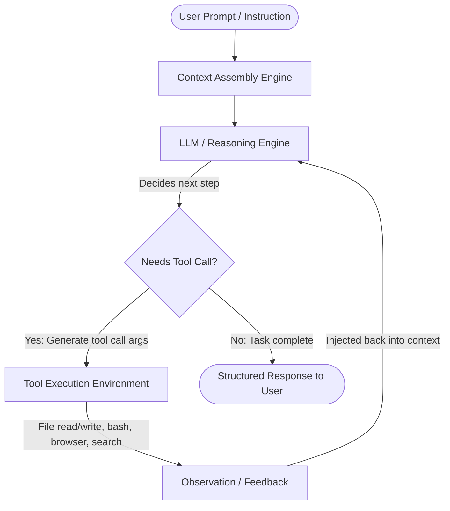

# Module 01: The Agent Mental Model & Tool Loop

Welcome to Module 01! In this module, you will learn the foundational mental model of how an Antigravity agent operates, how it perceives your project, and how it uses tools to turn natural language intent into working software.

---

## 🧠 1. Concept Briefing

### 1.1 Chatbot vs. Autonomous Agent

A traditional AI chatbot simply takes text in and sends text out in a single turn:
$$\text{User Prompt} \rightarrow \text{LLM} \rightarrow \text{Text Answer}$$

An **Antigravity Agent**, by contrast, is an **autonomous reasoning engine in a feedback loop** (often called the **ReAct pattern**: Reason + Act):

### 1.2 The Anatomy of Context

Every time you send a message, Antigravity constructs a rich context window. It includes:
1. **System Persona & Capabilities**: Built-in instructions, role definitions, and response constraints.
2. **Project Rules**: Guidelines discovered from `GEMINI.md`, `AGENTS.md`, or `.agents/rules/*.md`.
3. **Available Skills**: Lightweight headers (name & description) of skills available via *Progressive Disclosure*.
4. **IDE & Workspace State**: Your active files, cursor position, working directory, and operating system.
5. **Tool Schemas**: The exact definitions and parameter specifications for every tool the agent can call.
6. **Conversation History & Transcripts**: Previous turns, tool calls, and observations.

### 1.3 The Agent's Toolkit

Antigravity agents do not "guess" file contents or assume command outcomes. They actively explore and modify the environment using dedicated tools:

| Tool Category | Key Tools | Purpose |
| :--- | :--- | :--- |
| **Filesystem** | `view_file`, `write_to_file`, `replace_file_content`, `grep_search`, `list_dir` | Read, create, and precisely edit files without overwriting unrelated code. |
| **Terminal / OS** | `run_command`, `manage_task` | Run bash commands, build projects, start dev servers, inspect tests. |
| **Automation** | `schedule`, `browser_subagent` | Schedule background notifications or launch an automated headless browser. |
| **Artifacts** | Artifact generation in brain storage | Create living documents (plans, reports, diagrams) outside ephemeral chat. |

---

## 🧪 2. Hands-On Lab

Let's put this mental model into practice through three short exercises:

### Exercise 1.1: Environment Self-Discovery
Ask the agent to inspect the repository and report on its current environment.
> **Prompt to try in chat:**
> *"Agent, inspect our current repository and working directory using your tools, and tell me: What files exist, what is the current git status, and what tools do you have at your disposal?"*

### Exercise 1.2: Artifact Generation with Mermaid
Ask the agent to create an architecture diagram artifact. Artifacts are rendered in your IDE's auxiliary pane and persist across the project lifecycle.
> **Prompt to try in chat:**
> *"Create a visual artifact diagram showing the lifecycle of an Antigravity agent request from user prompt to tool execution to response."*

### Exercise 1.3: Workspace Snapshot & First Git Commit
Once you are comfortable with the findings, commit the Module 1 materials to your Git repository:
> **Prompt to try in chat:**
> *"Commit our training roadmap and Module 1 materials to git with a clear commit message."*

---

## 🎯 3. Checkpoint & Key Takeaways

Before moving to Module 02, verify that you can answer:
- [ ] Why is an agent more powerful than a simple LLM chat?
- [ ] What is the "ReAct" tool-use feedback loop?
- [ ] Where are artifacts stored, and why are they preferred over long chat dumps?
- [ ] What information does Antigravity automatically provide the agent in every turn?

👉 Once completed, you are ready for **[Module 02: Driving the Agent (Steering & Slash Commands)](../02-prompting-and-control/README.md)**!
