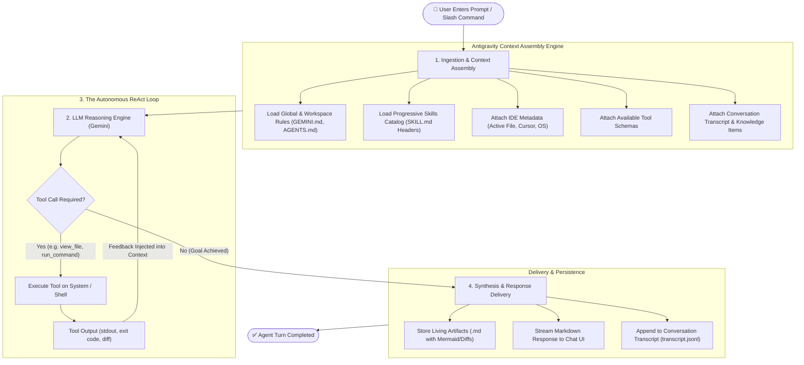
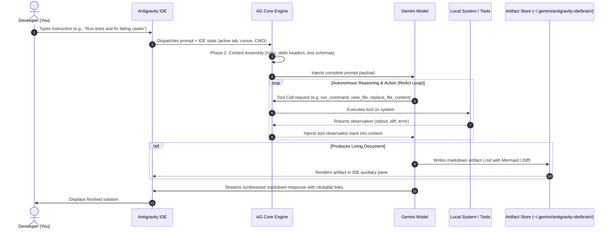

# Module 01: Lab Results & Output Documentation

This file documents the prompts executed during **Module 01: The Agent Mental Model & Tool Loop**, the tools called behind the scenes, and the resulting outputs.

---

## 📌 Exercise 1.1: Environment Self-Discovery

### User Prompt
```text
Agent, inspect our current repository and working directory using your tools, and tell me: What files exist, what is the current git status, and what tools do you have at your disposal?
```

### Tool Execution Trace
1. **`run_command`**: `pwd && ls -la && git status`
   - *Result:* Discovered root directory `/home/martin/workspace/AG-Projects/LearningAG` on branch `main` with clean working tree.
2. **`run_command`**: `git log --oneline -n 5 && find . -maxdepth 3 -not -path '*/.*'`
   - *Result:* Retrieved initial commit `13b07a6` and scanned workspace files.
3. **`list_dir`**: `/home/martin/workspace/AG-Projects/LearningAG/modules/01-agent-mental-model/lab`
   - *Result:* Confirmed existence of `EXERCISE.md`.

### Produced Output
* **Working Directory:** `/home/martin/workspace/AG-Projects/LearningAG`
* **Files Present:**
  * `README.md` – Main curriculum roadmap.
  * `modules/01-agent-mental-model/README.md` – Theory on agent mental model.
  * `modules/01-agent-mental-model/lab/EXERCISE.md` – Lab walkthrough.
* **Git Status:** Branch `main`, clean working tree.
* **Agent Tools at Disposal:**
  * **Filesystem:** `view_file`, `write_to_file`, `replace_file_content`, `multi_replace_file_content`, `list_dir`, `grep_search`
  * **Terminal/OS:** `run_command`, `manage_task`
  * **Web & Browser:** `search_web`, `read_url_content`, `browser_subagent`
  * **Automation & Interaction:** `schedule`, `ask_question`, `generate_image`

---

## 📌 Exercise 1.2: Artifact Generation with Mermaid

### User Prompt
```text
Create a visual artifact diagram showing the lifecycle of an Antigravity agent request from user prompt to tool execution to response.
```

### Tool Execution Trace
1. **`write_to_file`**: Wrote `agent_request_lifecycle.md` into the agent's brain artifact directory (`~/.gemini/antigravity-ide/brain/<conversation-id>/`).

### Produced Artifact
* **Artifact File:** `agent_request_lifecycle.md` (viewable in the IDE auxiliary pane)

#### Lifecycle Flowchart


#### Sequence Diagram of the Execution Loop


---

## 📌 Exercise 1.3: Git Commit & Progression

### User Prompt
```text
Commit our training roadmap and Module 1 materials to git with a clear commit message.
```

### Tool Execution Trace
1. **`git status`**: Inspected working directory status.
2. **`replace_file_content`**: Updated `README.md` to reflect Module 01 completion (`🟢 Completed`) and Module 02 setup (`🟡 In Progress`).
3. **`write_to_file`**: Created `modules/02-prompting-and-control/README.md` and `modules/02-prompting-and-control/lab/EXERCISE.md`.
4. **`run_command`**: Executed `git add . && git commit -m "feat: complete Module 1 and introduce Module 2 on steering and slash commands"`.

### Produced Output
```text
[main 9a20f34] feat: complete Module 1 and introduce Module 2 on steering and slash commands
 3 files changed, 137 insertions(+), 2 deletions(-)
 create mode 100644 modules/02-prompting-and-control/README.md
 create mode 100644 modules/02-prompting-and-control/lab/EXERCISE.md
```

---

## 🧠 Key Takeaways from Module 01

1. **ReAct is Not a Chatbot:** The agent reasons and executes tools iteratively rather than guessing.
2. **Progressive Disclosure:** Context stays lean and fast by loading skill metadata first and full instructions on demand.
3. **Artifacts Provide Persistence:** Complex diagrams and documentation live in dedicated auxiliary pane artifacts, keeping the conversation clean.
4. **Git as an Undo Mechanism:** Frequent commits give you full confidence to let the agent experiment safely.
