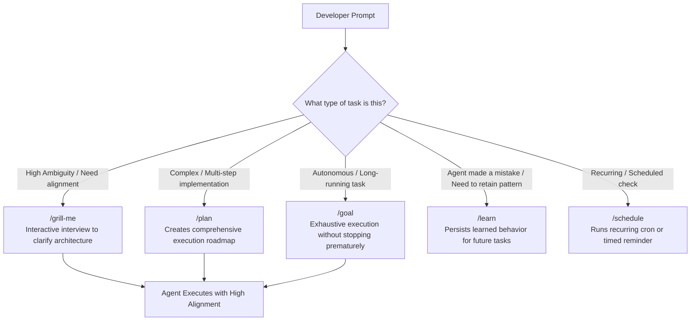

# Module 02: Driving the Agent (Steering & Slash Commands)

Welcome to Module 02! In this module, you will learn how to steer and guide an Antigravity agent effectively. You will transition from basic queries to using Antigravity's specialized slash commands and robust prompt patterns to manage complex software tasks.

---

## 🎯 1. Concept Briefing

### 1.1 The Anatomy of an Effective Agent Prompt

When working with an autonomous coding agent, vague instructions lead to generic or exploratory steps. High-performing agent prompts typically contain four core ingredients:

| Component | Purpose | Example |
| :--- | :--- | :--- |
| **1. Objective / Intent** | What needs to be achieved | *"Implement an exponential backoff retry utility for HTTP requests."* |
| **2. Architectural Constraints** | What rules or boundaries must be respected | *"Use native Fetch API only, zero third-party dependencies, TypeScript strict mode."* |
| **3. Verification Criteria** | How the agent should prove its work | *"Write unit tests with Jest achieving 100% branch coverage and run the test suite."* |
| **4. Deliverables** | Expected output format | *"Commit the implementation and tests to git, and summarize exported functions."* |

---

### 1.2 Specialized Slash Commands

Antigravity provides built-in slash commands to trigger specialized reasoning behaviors:

#### 🛠️ Slash Command Reference:

* **`/plan`**:
  * **When to use:** When starting any non-trivial feature or refactoring.
  * **Behavior:** The agent pauses immediate code changes and constructs a structured, phased execution plan. It asks for your feedback and approval before proceeding.

* **`/grill-me`**:
  * **When to use:** When you have an idea but haven't specified trade-offs, edge cases, error handling, or API design.
  * **Behavior:** The agent interviews *you*—asking challenging architectural questions until all ambiguities are resolved.

* **`/goal`**:
  * **When to use:** When delegating a long-running, autonomous task (e.g., refactoring a module, fixing a suite of 20 lint errors).
  * **Behavior:** The agent enters deep focus mode, systematically executing and verifying steps until the overarching objective is achieved.

* **`/learn`**:
  * **When to use:** When you correct the agent's behavior, point out a repository convention, or configure a tricky tool.
  * **Behavior:** The agent records this knowledge into a persistent rule or knowledge item so it never repeats the mistake in future sessions.

* **`/schedule`**:
  * **When to use:** When you want recurring notifications, periodic test runs, or a timed reminder.

---

### 1.3 The Mid-Flight Steering Loop

When an agent takes a sub-optimal turn, you don't need to wipe the chat or start over. Effective steering involves:
1. **Diff-oriented feedback:** Instead of *"That's wrong"*, specify *"Use immutable data structures in `store.ts` instead of in-place mutation."*
2. **Asking the agent to self-critique:** *"Run the linter and inspect why the build failed."*
3. **Rollback with Git:** If an agent took an unwanted exploratory tangent, run `git reset --hard HEAD` and restate your constraints.

---

## 🧪 2. Hands-On Lab

Head over to **[lab/EXERCISE.md](lab/EXERCISE.md)** to practice:
- **Exercise 2.1:** Sharpening requirements with `/grill-me`.
- **Exercise 2.2:** Formulating a structured implementation roadmap with `/plan`.
- **Exercise 2.3:** Correcting and teaching the agent with `/learn`.

---

## 🎯 3. Checkpoint & Key Takeaways

Before moving to Module 03, verify that you can answer:
- [ ] What are the four ingredients of an effective agent prompt?
- [ ] When should you trigger `/grill-me` vs. `/plan`?
- [ ] How does `/goal` change the agent's persistence behavior?
- [ ] Why is Git your best friend when pair programming with an agent?

👉 Once completed, you will be ready for **[Module 03: Custom Rules & Guardrails](../03-custom-rules/README.md)**!
