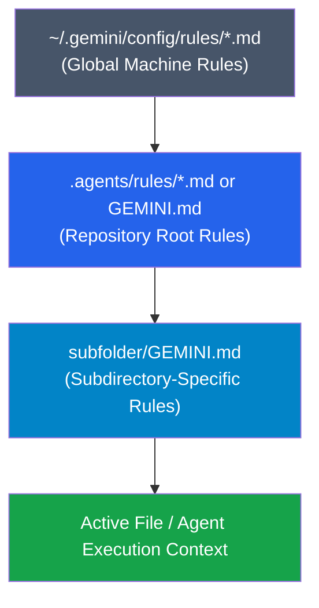

# Module 03: Custom Rules & Guardrails

Welcome to Module 03! In this module, you will learn how to teach the Antigravity agent your specific coding standards, architectural patterns, and safety guardrails using **Rules** (`GEMINI.md`, `AGENTS.md`, and `.agents/rules/*.md`).

---

## 🛡️ 1. Concept Briefing

### 1.1 Why Rules Matter

Without project rules, an AI agent relies entirely on its general training weights. It might format code using style conventions from another company, use libraries you have banned, or write tests with a framework you don't use.

**Rules** allow you to anchor the agent's behavior directly in your repository:
* They are checked into Git and shared with your whole team.
* They are automatically loaded into context every time the agent operates on relevant files.
* They prevent repetitive corrections.

---

### 1.2 Rule Types & Discovery Hierarchy

Antigravity discovers rules hierarchically by walking up the directory tree from the active file to the repository root:



1. **Global Configuration:** `~/.gemini/config/` (applies to all projects on your machine).
2. **Workspace Root Rules:** `.agents/rules/*.md`, `GEMINI.md`, or `AGENTS.md` (project-wide).
3. **Contextual / Directory Rules:** A `GEMINI.md` or rule inside a specific folder applies only when the agent inspects or edits files in that folder or its subdirectories.

---

### 1.3 Rule Anatomy & Frontmatter

Rule files are standard Markdown files that can optionally include YAML frontmatter:

```markdown
---
trigger: always_on
description: Mandatory Python coding standards and type annotations
---

# Python Coding Guidelines

1. Always use Python 3.12+ type hints on all function signatures.
2. Docstrings must follow Google style format.
3. Every public function must have unit test coverage.
4. Never use bare `except:` clauses.
```

* **`trigger: always_on`** (Default): Injected into every turn when working in that directory scope.
* **`trigger: model_decision`**: Only injected if the model determines the task matches the `description` (saves tokens for specialized rules).

---

## 🧪 2. Hands-On Lab

Head over to **[lab/EXERCISE.md](lab/EXERCISE.md)** to practice:
- **Exercise 3.1:** Creating your first project-level rule in `.agents/rules/`.
- **Exercise 3.2:** Testing agent compliance and verification.
- **Exercise 3.3:** Creating a localized, directory-specific rule.

---

## 🎯 3. Checkpoint & Key Takeaways

Before moving to Module 04, verify that you can answer:
- [ ] What is the difference between global rules, repository rules, and directory rules?
- [ ] When should a rule be `always_on` vs. `model_decision`?
- [ ] Why should project rules be committed to Git?

👉 Once completed, you will be ready for **[Module 04: Building Custom Skills](../04-building-skills/README.md)**!
