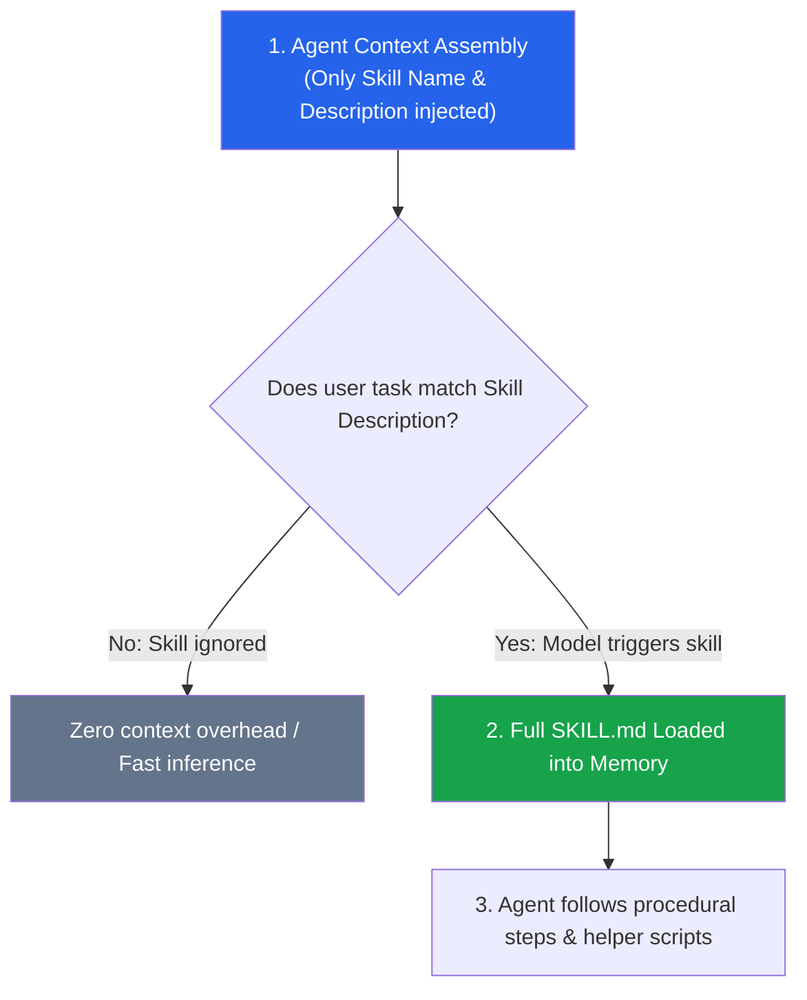

# Module 04: Building Custom Skills

Welcome to Module 04! In this module, you will learn how to teach the Antigravity agent multi-step procedural capabilities and runbooks using **Custom Skills** (`skills/<name>/SKILL.md`).

---

## ⚡ 1. Concept Briefing

### 1.1 The Crucial Difference: Rules vs. Skills

Developers often confuse Rules and Skills. Here is the mental model:

| Dimension | Rules (`rules/*.md`, `GEMINI.md`) | Skills (`skills/<name>/SKILL.md`) |
| :--- | :--- | :--- |
| **Purpose** | **Constraints & Guardrails** (*What NOT to do, style, boundaries*) | **Procedures & Capabilities** (*How to perform a multi-step task*) |
| **Analogy** | Traffic laws & building codes | A specialized repair manual or cookbook |
| **Examples** | Strict type hints, no mutable defaults, forbidden libraries | Database migration runbook, release checklist, performance benchmark |
| **Loading** | Injected directly into prompt (always-on or model decision) | Loaded strictly on-demand (*Progressive Disclosure*) |

---

### 1.2 Progressive Disclosure: Why Skills Scale

If an agent loaded 50 multi-page runbooks into every context window, it would:
1. Exhaust the context window.
2. Degrade reasoning quality due to token noise.
3. Cost significantly more per turn.

Antigravity solves this with **Progressive Disclosure**:



---

### 1.3 Skill Folder Structure

A skill lives in `.agents/skills/<skill_name>/` (or global `~/.gemini/config/skills/`):

```text
.agents/skills/release-checklist/
├── SKILL.md             # Required: YAML frontmatter + instructions
├── scripts/             # Optional: helper bash / python scripts
└── templates/           # Optional: templates or reference files
```

#### SKILL.md Anatomy:
```markdown
---
name: release-checklist
description: Verifies git status, runs tests, and prepares version tags for release. Activate when the user asks to prepare a release or tag a version.
---

# Release Preparation Procedure
1. Check that git working directory is clean.
2. Run test suite: `python3 -m unittest discover`.
3. Bump version string.
...
```

---

## 🧪 2. Hands-On Lab

Head over to **[lab/EXERCISE.md](lab/EXERCISE.md)** to practice:
- **Exercise 4.1:** Authoring a custom skill in `.agents/skills/`.
- **Exercise 4.2:** Triggering the skill on demand.
- **Exercise 4.3:** Observing progressive disclosure in action.

---

## 🎯 3. Checkpoint & Key Takeaways

Before moving to Module 05, verify that you can answer:
- [ ] What is the difference between a Rule and a Skill?
- [ ] What is Progressive Disclosure and why is it essential for token efficiency?
- [ ] What is the required filename and format for a custom skill?

👉 Once completed, you will be ready for **[Module 05: Advanced Tools & Automation](../05-advanced-tools/README.md)**!
