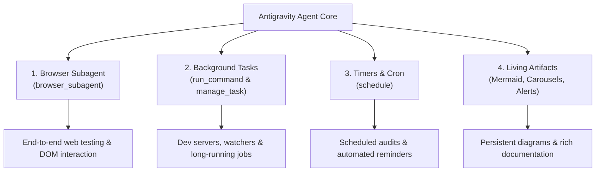

# Module 05: Advanced Tools & Automation

Welcome to Module 05! In this module, you will learn how to leverage Antigravity's advanced autonomous tools: the **Browser Subagent**, **Background Task Management**, **Schedulers & Timers**, and **Living Artifacts**.

---

## ⚡ 1. Concept Briefing

### 1.1 The Advanced Tool Arsenal

Beyond simple file edits, an Antigravity agent can interact with running processes, browsers, and background execution:

---

### 1.2 Browser Subagent (`browser_subagent`)

The Browser Subagent allows Antigravity to launch a dedicated headless browser:
* It can navigate to URLs, click buttons, fill out forms, inspect the DOM, and capture screenshots/recordings.
* It reports back observations to the main agent.
* Perfect for: Verifying web applications, frontend regression testing, and reading pages that require JavaScript rendering.

---

### 1.3 Asynchronous Execution & Background Tasks

When a command takes a long time (e.g. running a dev server or building a large project):
* `run_command` with `WaitMsBeforeAsync` sends the process into the background.
* The agent manages running processes using `manage_task` (`list`, `status`, `send_input`, `kill`).
* **Reactive Wakeup:** The agent is automatically woken up when a background task emits output or terminates—no wasteful polling loops needed!

---

### 1.4 Persistent Living Artifacts

Artifacts are markdown documents saved into `<appDataDir>/brain/<conversation-id>/`:
* **GitHub-style Alerts:** `[!NOTE]`, `[!TIP]`, `[!IMPORTANT]`, `[!WARNING]`, `[!CAUTION]`
* **Mermaid Visualizations:** Sequence diagrams, entity-relationship diagrams, flowcharts.
* **Carousels:** Sequential slide presentations inside markdown.
* **Diff Blocks:** Code changes formatted with `+` and `-`.

---

## 🧪 2. Hands-On Lab

Head over to **[lab/EXERCISE.md](lab/EXERCISE.md)** to practice:
- **Exercise 5.1:** Crafting an advanced multi-element living artifact with Mermaid and Alert callouts.
- **Exercise 5.2:** Running a background task and managing it via `manage_task`.
- **Exercise 5.3:** Setting an autonomous timer or schedule.

---

## 🎯 3. Checkpoint & Key Takeaways

Before moving to Module 06, verify that you can answer:
- [ ] How does `manage_task` allow agents to run persistent dev servers?
- [ ] What is Reactive Wakeup in Antigravity?
- [ ] Why are living artifacts superior to standard chat output for documentation?

👉 Once completed, you will be ready for **[Module 06: Extensibility (MCP & Hooks)](../06-mcp-and-hooks/README.md)**!
