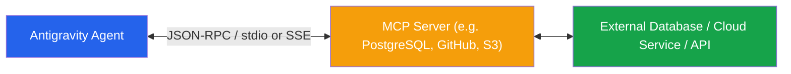
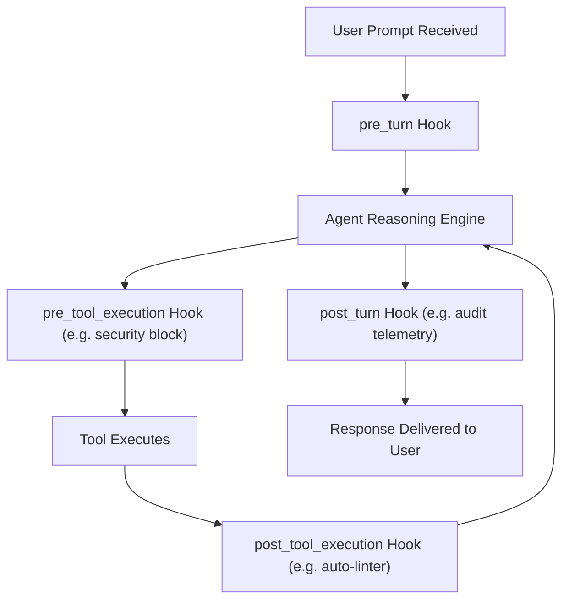

# Module 06: Extensibility (MCP & Hooks)

Welcome to Module 06! In this module, you will learn how to expand Antigravity's ecosystem using the **Model Context Protocol (MCP)** and **Lifecycle Hooks** (`hooks.json`).

---

## 🔌 1. Concept Briefing

### 1.1 Model Context Protocol (MCP)

The **Model Context Protocol (MCP)** is an open industry standard that connects AI models to external tools, databases, and enterprise services:



* **Configuration File:** `.agents/mcp_config.json` (workspace) or `~/.gemini/config/mcp_config.json` (global).
* **Protocol Modes:** `stdio` (subprocess commands) or `sse` (Server-Sent Events / HTTP).
* **Capabilities Exposed:** Tools, Resources (read-only data), and Prompts.

#### Example `mcp_config.json`:
```json
{
  "mcpServers": {
    "sqlite-memory": {
      "command": "python3",
      "args": ["-m", "mcp_server_sqlite", "--db-path", ":memory:"]
    }
  }
}
```

---

### 1.2 Lifecycle Hooks (`hooks.json`)

Hooks allow you to run custom deterministic scripts before or after agent lifecycle events:



#### Hook Event Types:
* **`pre_tool_execution`**: Run safety checks before a command or file edit executes. Can reject or modify execution.
* **`post_tool_execution`**: Run formatting or test runners automatically after a file is modified.
* **`pre_turn` / `post_turn`**: Run telemetry or setup scripts at conversation turn boundaries.

---

### 1.3 Packaging Everything: Plugins (`plugins/<name>/`)

When you want to bundle **Skills**, **Rules**, **Hooks**, and **MCP Servers** into a single shareable package for your team:
* Directory: `.agents/plugins/<plugin_name>/`
* Manifest: `plugin.json`
* Plugins allow reusable capabilities to be shared across multiple repositories without duplicate setup.

---

## 🧪 2. Hands-On Lab

Head over to **[lab/EXERCISE.md](lab/EXERCISE.md)** to practice:
- **Exercise 6.1:** Defining a custom MCP server configuration (`mcp_config.json`).
- **Exercise 6.2:** Writing a deterministic lifecycle hook (`hooks.json`).
- **Exercise 6.3:** Understanding plugin bundling.

---

## 🎯 3. Checkpoint & Key Takeaways

Before moving to the final Capstone Project (Module 07), verify that you can answer:
- [ ] What is the Model Context Protocol (MCP) and how does it connect external tools?
- [ ] What is the difference between a `pre_tool_execution` and `post_tool_execution` hook?
- [ ] How do Plugins bundle skills, rules, and MCP configurations together?

👉 Once completed, you will be ready for **[Module 07: The Capstone Project](../07-capstone-project/README.md)**!
