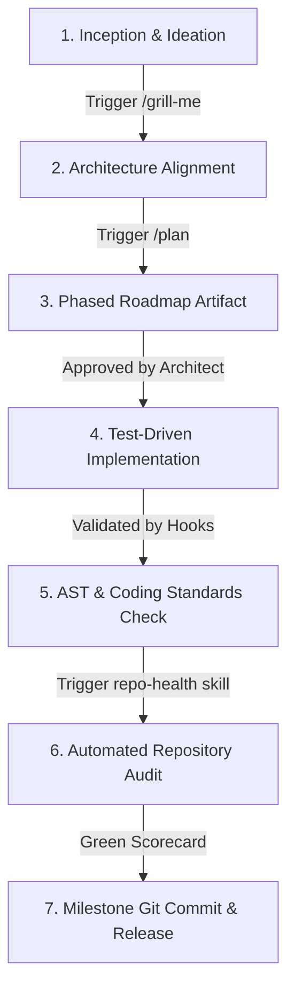

# Module 07: The Capstone Project

Welcome to the grand finale of the **Antigravity Agent Mastery** training curriculum! 🎓

In this Capstone Project, you step into the role of **Lead Architect and Engineering Director**. You will guide the Antigravity agent through building an end-to-end, production-ready project from blank canvas to verified delivery using everything you have learned.

---

## 🏆 1. The Capstone Challenge

### Your Role as Lead Architect
You do not need to write raw code line-by-line. Instead, you steer the agent using the full Antigravity toolkit:

---

## 💡 2. Recommended Capstone Ideas

You can choose any project idea you wish, or pick from one of these curated scenarios:

1. **API Benchmarking & Load Testing CLI (`bench-cli`):**
   * A Python CLI that concurrently pings an HTTP endpoint with N requests, measures latency percentiles ($p_{50}, p_{95}, p_{99}$), and prints a formatted terminal report.
2. **Markdown Knowledge Graph & Link Verifier (`doc-guard`):**
   * A documentation tool that scans all markdown files in a repository, validates relative file links, checks for broken anchors, and flags orphan pages.
3. **Configuration & Secret Leak Scanner (`sec-audit`):**
   * A security tool that scans git diffs or directories for accidental credential leaks (API keys, JWTs, AWS secret keys) using regex patterns and Shannon entropy.

---

## 🧪 3. The Capstone Execution Protocol

1. **Step 1: Alignment with `/grill-me`**  
   Present your project idea and let the agent interview you on architecture, dependencies, interface style, and edge cases.
2. **Step 2: Phased Plan with `/plan`**  
   Review the agent's architectural artifact, refine phase milestones, and approve execution.
3. **Step 3: Implementation & TDD**  
   The agent builds models, services, CLI/TUI interface, and unit tests adhering to `.agents/rules/standards.md`.
4. **Step 4: Quality & Standards Audit**  
   The `.agents/hooks/standards_linter.py` hook and `.agents/skills/repo-health` skill verify that all code compiles, all tests pass, and zero violations exist.
5. **Step 5: Documentation & Graduation**  
   Document the results in `modules/07-capstone-project/solution/result.md` and complete the curriculum!
